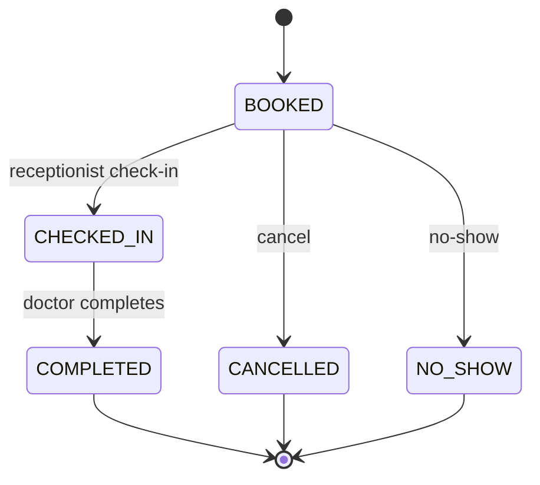

# Console Clinic Appointment System

## Submission cover

| Team member | Student ID |
|---|---|
| Onah Debeiwu Chrysanctus | Student1639236 |
| Okeke Chiemerie Miracle | Student1647235 |
| Okonkwo Samuel chiemerie | Student1627019 |

- Course / Module: Java development
- Instructor: Mr Kamsi
- Submission date: 20th November 2026

## 1. Project overview

This is a Java 17+ command-line application for a single clinic. It manages users, doctor
availability, appointments, pricing, waiting lists, visit records, notifications, and receptionist
reports. It has no GUI or database. Gson persists state in JSON files, and `pom.xml` declares
Gson 2.11.0 as the runtime dependency. (`Main.main`, `ClinicApp.open`, `pom.xml`)

### Architecture and layering

```text
ConsoleUI / CommandParser / command objects
                   |
                   v
          service use cases
                   |
                   v
          repository interfaces
                   |
                   v
     Gson JSON repositories / local files
```

Services also use domain objects, scheduling rules, pricing policies, factories, and event
publication. `ClinicApp.open` constructs the concrete JSON repositories, connects the services,
registers event listeners, and supplies a shared injected `Clock`. (`ClinicApp.open`,
`CommandContext`, `UserRepository`, `AppointmentRepository`)

### Project shape

The canonical application contains 110 Java source files across the `com.clinic` packages. It
includes a self-test harness rather than a separate `src/test/java` suite. The current tracked
deliverables also include a README, demo scripts, a requirements checklist, UML documentation,
Office reports, and saved verification output. (`SelfTest.main`, `pom.xml`)

## 2. Build, run, self-test, and demo

Run these commands from the repository root with Java 17+ and Maven installed.
(`pom.xml`)

```powershell
# Compile production sources
mvn -q clean compile

# Compile any test sources
mvn -q test-compile

# Create the executable shaded JAR
mvn clean package

# Start the console using the default ./data directory
java -jar target/clinic-app.jar

# Pin the clock and/or choose another data directory
java -jar target/clinic-app.jar --data=demo-data --now=2026-11-02T08:00

# Run the programmatic checks
java -cp target/clinic-app.jar com.clinic.SelfTest

# Run the three scripted demonstration sessions
powershell -ExecutionPolicy Bypass -File demo/run-demos.ps1
```

`Main` defaults to `data/`, accepts `--data=<folder>`, accepts ISO local date-time through
`--now=<yyyy-MM-ddTHH:mm>`, and prints usage for `--help`. The JAR manifest names
`com.clinic.Main`; the self-test is a separate main class in the same JAR. The demo runner builds
the JAR and runs three separate JVM sessions against its demo data folder. (`Main.run`,
`Main.printUsage`, `pom.xml`, `SelfTest.main`, `demo/run-demos.ps1`)

## 3. Brief compliance matrix

Statuses below reflect the 30 required rows in `docs/requirements-checklist.md`, plus its bonus
reminder behavior. “Missing” counts refer only to optional ideas listed after the requirements.
Evidence is cited in the last column. (Evidence classes/methods are named per row.)

| Requirement | Status | Evidence |
|---|---|---|
| Java console application, Java 17, Maven, Gson | MET | `pom.xml`, `Main.main` |
| Receptionist, doctor, and patient account roles | MET | `User`, `Receptionist`, `Doctor`, `Patient`, `Role` |
| Per-user salted password hash | MET | `PasswordHasher`, `UserFactory`, `AuthService.login` |
| Login lockout and receptionist unblock | MET | `User.recordFailedLogin`, `AuthService.login`, `AuthService.unlock` |
| Default receptionist and seeded demonstration data | MET | `SeedData.seedIfEmpty`, `AuthService.ensureDefaultReceptionist` |
| Role-filtered command access and help | MET | `Command.allowedRoles`, `CommandRegistry.visibleTo`, `ConsoleUI.isAllowed` |
| Doctor schedules, breaks, leave, slots, and capacity | MET | `Doctor`, `WorkingDay`, `LeavePeriod`, `ScheduleRules`, `SlotFinder` |
| Emergency schedule exceptions | MET | `Emergency`, `ScheduleRules.checkBookingWindow`, `ScheduleRules.checkWorkingHours` |
| Appointment types own duration, fee, and eligibility | MET | `AppointmentType`, `Consultation`, `FollowUp`, `Emergency` |
| Follow-up eligibility tied to a completed visit and doctor | MET | `BookingService.bookingContext`, `FollowUp.checkEligibility` |
| Booking conflict, horizon, notice, patient-limit, and block rules | MET | `BookingService.book`, `BookingService.validateSlot` |
| Free-slot suggestions after a conflict | MET | `SlotFinder.suggest`, `SlotUnavailableException` |
| Appointment lifecycle transitions | MET | `Appointment.transitionTo`, `AppointmentStatus` |
| Free/late cancellation and late fee | MET | `BookingService.cancel`, `BillingService.lateCancellationFee` |
| Validate-before-mutate rescheduling | MET | `BookingService.reschedule` |
| No-show history and temporary booking block | MET | `BookingService.markNoShow`, `Patient.recordNoShow`, `Patient.block` |
| Strategy pricing using decimal values | MET | `PricingPolicy`, `PricingPolicyFactory`, `BillingService.quote` |
| FIFO waiting-list offers and lazy expiry | MET | `WaitlistService.onSlotFreed`, `WaitlistService.expireOffers` |
| Append-only visit notes and access control | MET | `VisitService.addNote`, `VisitService.historyFor`, `VisitRecord` |
| Event notifications and audit log | MET | `EventBus.publish`, `NotificationInbox.onEvent`, `ActivityLog.onEvent` |
| Daily, utilisation, no-show, and revenue reports | MET | `ReportService.daily`, `ReportService.utilisation`, `ReportService.noShow`, `ReportService.revenue` |
| Command parsing, quoting, flags, and role-aware dispatch | MET | `CommandParser.parse`, `CommandRegistry.resolve`, `ConsoleUI.handle` |
| Gson JSON persistence and type reconstruction | MET | `JsonSupport.createGson`, `JsonUserRepository`, `UserFactory.fromJson` |
| Create missing files and replace snapshots safely | MET | `JsonSupport.readOrCreate`, `JsonSupport.writeAtomically` |
| Persistent ID sequences across restart | MET | `SequenceStore`, `SelfTest.main` |
| Concurrent booking serialization | MET | `BookingService.book`, `SelfTest.main` |
| CLI/service/repository separation and injected clock | MET | `ClinicApp.open`, `CommandContext`, service constructors |
| Domain error handling at the console boundary | MET | `ConsoleUI.handle`, `ClinicException` |
| Seed volume and lifecycle variety | MET | `SeedData.seedIfEmpty`, `Main.printBanner` |
| README, UML, demo material, and verification harness | MET | `README.md`, `docs/uml.md`, `docs/DEMO.md`, `SelfTest.main` |
| Patient reminders surfaced through the notification inbox | MET (bonus) | `NotificationInbox.unreadCount`, `LoginCommand.perform`, `InboxCommand` |
| Patient history export as a separate user-requested export | MISSING (optional) | History is persisted, but no export command exists; `VisitService.historyFor`, `VisitRecordRepository` |
| Recurring appointments | MISSING (optional) | No recurring-appointment command or service |
| Weekly calendar view | MISSING (optional) | The CLI provides a day grid; `SlotsCommand`, `SchedulingService.describeDay` |
| Automatic doctor assignment | MISSING (optional) | Booking requires a doctor ID; `BookingService.book` |

**Count:** 31 MET (30 required plus one bonus), 0 PARTIAL, 4 MISSING optional ideas. The missing
optional rows separate the history-export idea from recurring appointments, a weekly calendar,
and automatic doctor assignment. (`VisitService`, `SchedulingService`, `BookingService`)

## 4. Domain model

### User hierarchy

```text
User (abstract)
├── Receptionist
├── Doctor
└── Patient
```

`User` stores common identity and authentication state. `Doctor` adds specialty, weekly schedule,
leave, and capacity; `Patient` adds birth date, category, insurer, block state, and no-show
history; `Receptionist` supplies the receptionist role. JSON reconstruction uses the persisted
type discriminator and `UserFactory`. (`User`, `Doctor`, `Patient`, `Receptionist`,
`UserFactory.fromJson`)

### Appointment type hierarchy

```text
AppointmentType (abstract)
├── Consultation  — 30 minutes, base fee 5,000
├── FollowUp      — 15 minutes, base fee 3,000
└── Emergency     — 20 minutes, base fee 10,000
```

Type objects encapsulate duration, fees, break/capacity/window behavior, and eligibility.
`Appointment` stores the type code and current lifecycle state; `AppointmentTypeFactory` maps
the code to behavior. (`AppointmentType`, `Consultation`, `FollowUp`, `Emergency`,
`AppointmentTypeFactory.forCode`, `Appointment`)

### Appointment lifecycle



The model validates allowed transitions: `BOOKED` can become checked in, cancelled, or no-show;
`CHECKED_IN` can become completed; completed/cancelled/no-show are final. (`Appointment.transitionTo`,
`Appointment.isAllowedTransition`, `AppointmentStatus`)

## 5. Scheduling engine

`TimeRange` is a half-open interval `[start, end)`. Its overlap test is
`start < other.end && other.start < end`; touching intervals are not overlapping.
(`TimeRange.overlaps`)

| First interval | Second interval | Overlap? |
|---|---|---|
| `[09:00, 09:30)` | `[09:30, 10:00)` | No |
| `[09:00, 09:30)` | `[09:15, 09:45)` | Yes |
| `[09:00, 10:00)` | `[09:15, 09:30)` | Yes |
| `[09:00, 09:30)` | `[10:00, 10:30)` | No |

`ScheduleRules` defines the 15-minute boundary, maximum booking horizon, minimum notice, working
hours, break, leave, and booking-window checks. `SlotFinder` uses those rules to test a candidate,
enumerate daily free starts, suggest later alternatives, and build a display grid. `SchedulingService`
combines it with doctor and appointment repositories. (`ScheduleRules.isSlotBoundary`,
`ScheduleRules.checkWorkingHours`, `ScheduleRules.checkBookingWindow`, `SlotFinder.isFree`,
`SlotFinder.freeSlots`, `SlotFinder.suggest`, `SlotFinder.describeDay`,
`SchedulingService.freeSlots`)

## 6. Booking validation: 12 ordered groups

For a normal `BookingService.book` request, validation follows this order. Items combine related
predicates into 12 groups without changing the order in which the source checks them.
(`BookingService.book`, `BookingService.validateSlot`)

| # | Check | Failure exception |
|---:|---|---|
| 1 | Actor is authenticated and may book for this patient | `UnauthorizedActionException` (`BookingService.requireCanBookFor`) |
| 2 | Patient exists and is not blocked | `PatientNotFoundException`, `PatientBlockedException` (`BookingService.requirePatient`, `BookingService.requireNotBlocked`) |
| 3 | Doctor exists | `DoctorNotFoundException` (`BookingService.requireDoctor`) |
| 4 | Start is on a slot boundary and appointment type code is valid | `InvalidInputException` (`BookingService.requireSlotBoundary`, `BookingService.requireType`) |
| 5 | Type-specific eligibility holds (for example follow-up history) | `FollowUpNotEligibleException` (`FollowUp.checkEligibility`) |
| 6 | Start is future, within horizon, same-day when required, and meets notice | `SlotUnavailableException` (`ScheduleRules.checkBookingWindow`) |
| 7 | Doctor works that date, is not on leave, and range fits hours/break rules | `DoctorOnLeaveException`, `OutsideWorkingHoursException` (`ScheduleRules.checkWorkingHours`) |
| 8 | No blocking appointment overlaps for the doctor | `SlotUnavailableException` (`BookingService.validateSlot`) |
| 9 | No blocking appointment overlaps for the patient | `SlotUnavailableException` (`BookingService.validateSlot`) |
| 10 | No active offer holds the slot for another patient | `SlotUnavailableException` (`BookingService.validateSlot`) |
| 11 | Doctor daily capacity is available, unless type ignores it | `SlotUnavailableException` (`BookingService.requireDailyCapacity`) |
| 12 | Patient has fewer than three active upcoming appointments | `BookingLimitExceededException` (`BookingService.requireBookingLimit`) |

After these checks, booking obtains a pricing quote, constructs the appointment, persists it, and
publishes the booked event. Rescheduling validates the new slot before mutating the existing
appointment. (`BookingService.book`, `BookingService.reschedule`)

## 7. Pricing examples

`BillingService.quote` selects a policy through `PricingPolicyFactory`; fees use `BigDecimal`
with two decimal places and `RoundingMode.HALF_UP`.
Senior status is derived from date of birth on the pricing date and takes precedence over a
registered insured category. (`BillingService.quote`, `Patient.pricingCategoryOn`,
`PricingPolicyFactory.forCategory`)

| Policy | Consultation base fee | Patient share | Insurer share |
|---|---:|---:|---:|
| Standard | 5,000 | 5,000 | 0 |
| Insured | 5,000 | 1,500 (30%) | 3,500 (70%) |
| Senior (65+) | 5,000 | 4,000 (20% discount) | 0 |

`BillingService.lateCancellationFee` calculates the late fee as 20% of the type’s base fee.
(`BillingService.lateCancellationFee`, `BookingService.cancel`, `InsuredPricing`,
`SeniorPricing`, `StandardPricing`)

## 8. Waiting-list offer lifecycle

When a slot is freed, `WaitlistService.onSlotFreed` scans matching entries in creation order and
offers the slot to the first eligible entry. The offer expiry is:

```text
holdUntil = now + 2 hours
cutoff    = slotStart - 1 hour
expiresAt = min(holdUntil, cutoff)
```

Entries whose expiry is not after `now` are skipped. Accepting routes back through the normal
booking gateway and marks the entry accepted; declining, leaving, or expiry can pass the slot to
the next matching entry. Expiry is lazy: startup and command handling call `expireOffers`; there
is no background scheduler. (`WaitlistService.onSlotFreed`, `WaitlistService.accept`,
`WaitlistService.decline`, `WaitlistService.expireOffers`, `ConsoleUI.expireWaitlistOffers`)

## 9. Persistence, integrity, and thread safety

| File | Persisted data |
|---|---|
| `data/users.json` | Receptionists and patients |
| `data/doctors.json` | Doctors, schedules, leave, and capacity |
| `data/appointments.json` | Appointments, statuses, fees, and timestamps |
| `data/waitlist.json` | Waiting-list requests and offers |
| `data/visit-records.json` | Clinical records and amendments |
| `data/notifications.json` | Inbox entries |
| `data/sequences.json` | Entity ID sequences |
| `data/activity.log` | Append-only event log |

`JsonSupport.createGson` configures date/time and `BigDecimal` adapters. `JsonSupport.readOrCreate`
creates missing data files, and `JsonSupport.writeAtomically` writes a sibling temporary file and
moves it over the destination. Corrupt JSON becomes `StorageException`; startup reports the
failure and exits with status 1 rather than proceeding with partial state. (`JsonSupport`,
`JsonSupport.readOrCreate`, `JsonSupport.writeAtomically`, `JsonSupport.corrupt`, `Main.run`)

`SequenceStore` persists IDs. `BookingService` uses one `ReentrantLock` around booking mutations,
and JSON repositories synchronize their save methods. The self-test races two requests for the
same slot and verifies exactly one succeeds. (`SequenceStore`, `BookingService.bookingLock`,
`SelfTest.main`)

Example appointment JSON (illustrative values):

```json
{
  "id": 101,
  "patientId": 15,
  "doctorId": 2,
  "type": "CONSULTATION",
  "start": "2026-11-10T09:00:00",
  "end": "2026-11-10T09:30:00",
  "status": "BOOKED",
  "baseFee": "5000.00",
  "patientShare": "5000.00",
  "insurerShare": "0.00"
}
```

The JSON field names correspond to the persisted `Appointment` fields and the adapters configured
by `JsonSupport.createGson`. (`Appointment`, `JsonSupport.createGson`,
`JsonAppointmentRepository`)

## 10. CLI commands

`CommandRegistry` registers 31 command objects. Exact authorization is declared by each command;
the table groups commands by common role/use rather than implying broader access than the
registry grants. (`CommandRegistry`)

| Command family | Commands | Implementation |
|---|---|---|
| Session | `login`, `logout`, `help`, `exit` | `SessionCommands.java` |
| Shared | `inbox`, `slots` | `InboxCommand`, `SlotsCommand` |
| Booking | `book`, `reschedule`, `cancel`, `myappointments` | `BookingCommands` |
| Waiting list | `waitlist join/accept/leave/decline/list` | `WaitlistCommands` |
| Patient administration | `patient add/unblock/list` | `PatientCommands` |
| Doctor administration | `doctor add/schedule/leave/list` | `DoctorCommands` |
| Appointment lifecycle | `checkin`, `complete`, `noshow` | `LifecycleCommands` |
| Clinical records | `visit note`, `history` | `VisitCommands` |
| Reports | `report daily/utilisation/noshow/revenue` | `ReportCommands` |

`CommandParser` supports quoted values and flags in `--name=value` or `--name value` form.
`ConsoleUI.handle` catches expected clinic errors and prints `Error: <message>`; unexpected
runtime errors print `Unexpected error: <message>`. (`CommandParser.parse`,
`ParsedCommand.requiredPositional`, `ConsoleUI.handle`, `ConsoleUI.printUnexpected`)

### Exception-to-console mapping

The text following the prefix is the exception’s own message; actual wording depends on context.
(`ConsoleUI.handle`, exception constructors)

| Exception | Console output behavior |
|---|---|
| `InvalidInputException` | `Error: <validation or usage message>` |
| `UnauthorizedActionException` | `Error: <role/ownership message>` |
| `SlotUnavailableException` | `Error: <slot conflict/window message>`; a conflict may include suggested slots |
| `PatientBlockedException` | `Error: <booking block message>` |
| `InvalidStatusTransitionException` | `Error: <invalid lifecycle transition message>` |
| `StorageException` during startup | `Cannot start the clinic system: <storage detail>`; process exit status 1 |
| Unexpected `RuntimeException` in command handling | `Unexpected error: <message>` |

`Main.run` is the startup boundary for corrupt/unreadable persisted files; `ConsoleUI.handle` is
the command boundary for domain errors. (`Main.run`, `ConsoleUI.handle`)

## 11. Testing and verification

The latest self-test run completed with:

```text
SelfTest finished: 40 passed, 0 failed.
ALL SELF-TEST CHECKS PASSED
```

The 40 checks cover interval overlap, appointment types, all pricing strategies, booking
validation, suggestions, cancellation fees, atomic rescheduling, no-show block/unblock,
waiting-list offers, lifecycle transitions, visits, password hashing, concurrent booking,
event logging, restart persistence, and continuing IDs. The harness exits nonzero when a check
fails. (`SelfTest.main`, `SelfTest.check`, `SelfTest.expect`)

Build verification on JDK 25 (compiler release 17) completed as follows:

```text
mvn -q clean compile  -> exit 0; no Maven diagnostics
mvn -q test-compile   -> exit 0; no Maven diagnostics
mvn clean package     -> BUILD SUCCESS
```

PowerShell emitted a standalone `Access is denied.` line before Maven output; all Maven
commands still returned exit code 0.

The Maven shade manifest overlap warning was resolved by excluding Gson’s manifest before
assembly. (`pom.xml`, Maven Shade Plugin configuration)

## 12. Key design decisions and design patterns

| Pattern | Use in this project | Evidence |
|---|---|---|
| Repository | Services depend on interfaces; JSON classes implement them | `AppointmentRepository`, `JsonAppointmentRepository`, `ClinicApp.open` |
| Strategy | Pricing algorithms are separate policy implementations | `PricingPolicy`, `StandardPricing`, `InsuredPricing`, `SeniorPricing` |
| Factory | Maps type codes/categories and reconstructs account subtypes | `AppointmentTypeFactory`, `PricingPolicyFactory`, `UserFactory.fromJson` |
| Observer | Domain events feed inbox and activity-log listeners | `EventBus`, `NotificationInbox`, `ActivityLog` |
| Command | One command object per CLI operation; registry resolves names and roles | `Command`, `CommandRegistry`, `CommandSupport` |
| Polymorphism | Roles and appointment types specialize shared behavior | `User`, `AppointmentType`, concrete subclasses |
| Composition root / manual DI | Concrete repositories and services are constructed in one place | `ClinicApp.open` |

## 13. Self-scored rubric

This is a reasoned self-assessment, not an external grade. Scores use the requested 30/25/15/10/10/5/5 weighting and cite evidence in the final tree.

| Area | Weight | Score | Evidence |
|---|---:|---:|---|
| Functional requirements | 30 | 28 | 30 required checklist rows are met; optional features remain; `docs/requirements-checklist.md`, `BookingService.book` |
| Architecture and object-oriented design | 25 | 23 | Layered CLI/services/repositories, model subtypes, strategies, factories, events; `ClinicApp.open`, `User`, `AppointmentType`, `PricingPolicy` |
| Persistence and integrity | 15 | 14 | Atomic JSON replacement, persisted sequences, corrupt-data failure path; `JsonSupport.writeAtomically`, `SequenceStore`, `Main.run` |
| CLI and user interaction | 10 | 9 | Role-filtered commands, parsing, exception boundary; `CommandRegistry.visibleTo`, `CommandParser.parse`, `ConsoleUI.handle` |
| Testing and verification | 10 | 9 | 40 executable checks including concurrency and restart scenarios; `SelfTest.main` |
| Technical documentation | 5 | 4 | README, requirements map, UML, detailed project guide; `README.md`, `docs/uml.md`, `docs/requirements-checklist.md` |
| Presentation and demonstration | 5 | 4 | 16-slide deck and three-session scripted demo; `docs/Clinic_Appointment_System_Presentation.pptx`, `demo/run-demos.ps1` |
| **Total** | **100** | **91** | Self-assessed against the evidence above |

## 14. Limitations and future work

The application is a single-clinic console program with local JSON persistence. The optional
separate patient-history export, recurring appointments, weekly calendar view, and automatic
doctor assignment are not implemented. `SelfTest` is a custom executable harness rather than a
JUnit suite. (`Main`, `JsonSupport`, `VisitService`, `SchedulingService`, `SelfTest`)

Possible future work, not current functionality: history export, recurring bookings, weekly
calendar display, doctor assignment by specialty, and adding a database-backed repository
implementation. The repository interfaces provide the storage boundary for such a future
implementation. (`VisitRecordRepository`, `AppointmentRepository`, `UserRepository`)

## 15. Viva questions and short answers

| # | Question | Model answer |
|---:|---|---|
| 1 | Why is the application console-only? | The project scope focuses on scheduling rules and object-oriented design; `Main` starts `ConsoleUI`. |
| 2 | Where are business rules enforced? | In services and domain types, not in command parsing; see `BookingService.book` and `Appointment.transitionTo`. |
| 3 | Why use repository interfaces? | They isolate services from JSON details; `ClinicApp.open` supplies the concrete implementations. |
| 4 | Why inject `Clock`? | It makes time-dependent rules reproducible; constructors in `BookingService` and `SlotFinder` receive it. |
| 5 | What makes `TimeRange` half-open? | The overlap expression excludes a touching end/start boundary; see `TimeRange.overlaps`. |
| 6 | How are slots aligned? | `ScheduleRules.isSlotBoundary` requires 15-minute increments with zero seconds/nanoseconds. |
| 7 | How does the system prevent double booking? | It validates overlap and serializes booking writes with `BookingService.bookingLock`. |
| 8 | Why validate a reschedule before changing it? | A failed target check leaves the original appointment intact; see `BookingService.reschedule`. |
| 9 | How does a follow-up become eligible? | `FollowUp.checkEligibility` checks same-doctor completed-visit context within its allowed interval. |
| 10 | How are fees split? | `BillingService.quote` selects a `PricingPolicy` from `PricingPolicyFactory`. |
| 11 | How is senior pricing determined? | `Patient.pricingCategoryOn` derives it from age on the pricing date. |
| 12 | What does an emergency appointment change? | `Emergency` permits break use, ignores daily capacity, is same-day, and waives minimum notice. |
| 13 | How are invalid lifecycle transitions handled? | `Appointment.transitionTo` throws `InvalidStatusTransitionException`. |
| 14 | How are waiting-list candidates ordered? | `WaitlistService` orders by creation time and then ID. |
| 15 | How long is a waiting-list offer held? | Until the earlier of two hours after now or one hour before slot start; see `WaitlistService.onSlotFreed`. |
| 16 | Does waiting-list expiry use a background thread? | No; `ConsoleUI` and startup invoke `WaitlistService.expireOffers`. |
| 17 | How do event listeners receive events? | Services publish to `EventBus`; `NotificationInbox` and `ActivityLog` are registered listeners. |
| 18 | How are passwords persisted? | A per-user salt and hash are persisted; see `PasswordHasher` and `UserFactory`. |
| 19 | What happens when JSON is corrupt? | `JsonSupport` raises `StorageException`; `Main.run` reports startup failure and exits with status 1. |
| 20 | How are identifiers preserved across restarts? | `SequenceStore` saves the counters in `data/sequences.json`. |
| 21 | What checks the doctor’s weekly schedule? | `ScheduleRules.checkWorkingHours` and `Doctor.workingDay` use schedule and leave data. |
| 22 | What is tested by the concurrency check? | Two booking threads race for one slot and exactly one succeeds; see `SelfTest.main`. |
| 23 | Why are visit records append-only? | Corrections create amendments instead of overwriting history; see `VisitService.addNote`. |
| 24 | Which roles may read clinical history? | Patients read their own, doctors read patients they have treated, and receptionists are denied; see `VisitService.historyFor`. |
| 25 | What does the daily report show? | `ReportService.daily` returns one doctor’s appointments for one date. |
| 26 | What library is used for JSON? | Gson 2.11.0 is declared in `pom.xml`; repositories share `JsonSupport.createGson`. |

## 16. Five-minute demonstration script

The scripted demo pins the clock to 2 November 2026 at 08:00 and uses separate JVM processes
against the same data directory. (`docs/DEMO.md`, `demo/run-demos.ps1`, `Main.run`)

| Time | Demonstration | Commands / talking points |
|---|---|---|
| 0:00–0:35 | Launch and login | `mvn clean package`; run with `--data=demo-data --now=2026-11-02T08:00`; show the loaded-data banner. (`Main.printBanner`) |
| 0:35–1:15 | Slot grid | `login 1 admin123`, `slots 2 2026-11-02`; point out booked cells, break, and available capacity. (`SlotsCommand`, `SlotFinder.describeDay`) |
| 1:15–2:00 | Booking conflict and pricing | Book for insured patient 7 at 10:00, then try patient 8 at 10:15; show rejection and free-slot suggestions. (`BookingService.book`, `SlotFinder.suggest`, `BillingService.quote`) |
| 2:00–2:45 | Cancellation and waitlist | Join the afternoon list, cancel appointment 10, show inbox offer, and accept it. (`WaitlistService.join`, `WaitlistService.onSlotFreed`, `WaitlistService.accept`) |
| 2:45–3:35 | No-show block | Mark the pending appointment no-show, show patient 9 blocked from booking, then receptionist unblocks. (`BookingService.markNoShow`, `AuthService.unlock`) |
| 3:35–4:35 | Visit lifecycle | Check in appointment 9, add a visit note, complete the appointment, and show patient history. (`BookingService.checkIn`, `VisitService.addNote`, `BookingService.complete`, `VisitService.historyFor`) |
| 4:35–5:00 | Verification and restart | Run `java -cp target/clinic-app.jar com.clinic.SelfTest`; point out persistence and ID-continuation checks. (`SelfTest.main`, `SequenceStore`) |

## Appendix A. File inventory

The following inventory records the tracked source and deliverable paths under the requested
project scope, plus the required root build/README files. Images and Office deliverables are
listed because they are part of the checked-in submission. (`git ls-files src pom.xml README.md demo docs`)

```text
README.md
pom.xml
demo/01-booking-waitlist.txt
demo/02-noshow-block.txt
demo/03-visits-followup.txt
demo/run-demos.ps1
docs/Clinic_Appointment_System_Documentation.docx
docs/Clinic_Appointment_System_Presentation.pptx
docs/Clinic_Appointment_System_Project_Brief.pdf
docs/DEMO.md
docs/PROJECT_GUIDE.md
docs/build/out_noshow.txt
docs/build/out_selftest.txt
docs/build/out_slots.txt
docs/images/architecture.png
docs/images/booking_pipeline.png
docs/images/lifecycle.png
docs/images/slide_architecture.png
docs/images/slide_booking_pipeline.png
docs/images/slide_lifecycle.png
docs/images/slide_slot_grid.png
docs/images/slide_terminal_block.png
docs/images/slide_terminal_booking.png
docs/images/slide_uml_pricing.png
docs/images/slide_uml_users.png
docs/images/slide_waitlist_flow.png
docs/images/slot_grid.png
docs/images/terminal_booking.png
docs/images/terminal_noshow.png
docs/images/terminal_selftest.png
docs/images/terminal_slots.png
docs/images/uml_appointments.png
docs/images/uml_pricing.png
docs/images/uml_users.png
docs/images/waitlist_flow.png
docs/requirements-checklist.md
docs/uml.md
src/main/java/com/clinic/ClinicApp.java
src/main/java/com/clinic/Main.java
src/main/java/com/clinic/SeedData.java
src/main/java/com/clinic/SelfTest.java
src/main/java/com/clinic/cli/BookingCommands.java
src/main/java/com/clinic/cli/Command.java
src/main/java/com/clinic/cli/CommandContext.java
src/main/java/com/clinic/cli/CommandParser.java
src/main/java/com/clinic/cli/CommandRegistry.java
src/main/java/com/clinic/cli/CommandSupport.java
src/main/java/com/clinic/cli/ConsoleUI.java
src/main/java/com/clinic/cli/DoctorCommands.java
src/main/java/com/clinic/cli/InboxCommand.java
src/main/java/com/clinic/cli/LifecycleCommands.java
src/main/java/com/clinic/cli/ParsedCommand.java
src/main/java/com/clinic/cli/PatientCommands.java
src/main/java/com/clinic/cli/ReportCommands.java
src/main/java/com/clinic/cli/SessionCommands.java
src/main/java/com/clinic/cli/SlotsCommand.java
src/main/java/com/clinic/cli/Table.java
src/main/java/com/clinic/cli/VisitCommands.java
src/main/java/com/clinic/cli/WaitlistCommands.java
src/main/java/com/clinic/event/ActivityLog.java
src/main/java/com/clinic/event/ClinicEvent.java
src/main/java/com/clinic/event/EventBus.java
src/main/java/com/clinic/event/EventListener.java
src/main/java/com/clinic/event/EventType.java
src/main/java/com/clinic/event/NotificationInbox.java
src/main/java/com/clinic/exception/AccountLockedException.java
src/main/java/com/clinic/exception/AppointmentNotFoundException.java
src/main/java/com/clinic/exception/AuthenticationException.java
src/main/java/com/clinic/exception/BookingLimitExceededException.java
src/main/java/com/clinic/exception/CancellationNotAllowedException.java
src/main/java/com/clinic/exception/ClinicException.java
src/main/java/com/clinic/exception/DoctorNotFoundException.java
src/main/java/com/clinic/exception/DoctorOnLeaveException.java
src/main/java/com/clinic/exception/FollowUpNotEligibleException.java
src/main/java/com/clinic/exception/InvalidInputException.java
src/main/java/com/clinic/exception/InvalidStatusTransitionException.java
src/main/java/com/clinic/exception/OutsideWorkingHoursException.java
src/main/java/com/clinic/exception/PatientBlockedException.java
src/main/java/com/clinic/exception/PatientNotFoundException.java
src/main/java/com/clinic/exception/SlotUnavailableException.java
src/main/java/com/clinic/exception/StorageException.java
src/main/java/com/clinic/exception/UnauthorizedActionException.java
src/main/java/com/clinic/exception/WaitlistEntryNotFoundException.java
src/main/java/com/clinic/factory/AppointmentTypeFactory.java
src/main/java/com/clinic/factory/PricingPolicyFactory.java
src/main/java/com/clinic/factory/UserFactory.java
src/main/java/com/clinic/model/Appointment.java
src/main/java/com/clinic/model/AppointmentStatus.java
src/main/java/com/clinic/model/AppointmentType.java
src/main/java/com/clinic/model/AppointmentTypeCode.java
src/main/java/com/clinic/model/BookingContext.java
src/main/java/com/clinic/model/Consultation.java
src/main/java/com/clinic/model/Doctor.java
src/main/java/com/clinic/model/Emergency.java
src/main/java/com/clinic/model/FollowUp.java
src/main/java/com/clinic/model/LeavePeriod.java
src/main/java/com/clinic/model/Notification.java
src/main/java/com/clinic/model/Patient.java
src/main/java/com/clinic/model/PatientCategory.java
src/main/java/com/clinic/model/Receptionist.java
src/main/java/com/clinic/model/Role.java
src/main/java/com/clinic/model/TimeWindow.java
src/main/java/com/clinic/model/User.java
src/main/java/com/clinic/model/VisitRecord.java
src/main/java/com/clinic/model/WaitlistEntry.java
src/main/java/com/clinic/model/WaitlistStatus.java
src/main/java/com/clinic/model/WorkingDay.java
src/main/java/com/clinic/pricing/InsuredPricing.java
src/main/java/com/clinic/pricing/PricingPolicy.java
src/main/java/com/clinic/pricing/SeniorPricing.java
src/main/java/com/clinic/pricing/StandardPricing.java
src/main/java/com/clinic/repository/ActivityLogRepository.java
src/main/java/com/clinic/repository/AppointmentRepository.java
src/main/java/com/clinic/repository/JsonActivityLogRepository.java
src/main/java/com/clinic/repository/JsonAppointmentRepository.java
src/main/java/com/clinic/repository/JsonNotificationRepository.java
src/main/java/com/clinic/repository/JsonSupport.java
src/main/java/com/clinic/repository/JsonUserRepository.java
src/main/java/com/clinic/repository/JsonVisitRecordRepository.java
src/main/java/com/clinic/repository/JsonWaitlistRepository.java
src/main/java/com/clinic/repository/NotificationRepository.java
src/main/java/com/clinic/repository/SequenceStore.java
src/main/java/com/clinic/repository/UserRepository.java
src/main/java/com/clinic/repository/VisitRecordRepository.java
src/main/java/com/clinic/repository/WaitlistRepository.java
src/main/java/com/clinic/scheduling/ScheduleRules.java
src/main/java/com/clinic/scheduling/SlotCell.java
src/main/java/com/clinic/scheduling/SlotFinder.java
src/main/java/com/clinic/scheduling/SlotState.java
src/main/java/com/clinic/scheduling/TimeRange.java
src/main/java/com/clinic/service/AuthService.java
src/main/java/com/clinic/service/BillingService.java
src/main/java/com/clinic/service/BookingGateway.java
src/main/java/com/clinic/service/BookingService.java
src/main/java/com/clinic/service/CreatedAccount.java
src/main/java/com/clinic/service/DailyScheduleReport.java
src/main/java/com/clinic/service/NoShowReport.java
src/main/java/com/clinic/service/PricingQuote.java
src/main/java/com/clinic/service/ReportService.java
src/main/java/com/clinic/service/RevenueReport.java
src/main/java/com/clinic/service/SchedulingService.java
src/main/java/com/clinic/service/UtilisationReport.java
src/main/java/com/clinic/service/VisitService.java
src/main/java/com/clinic/service/WaitlistService.java
src/main/java/com/clinic/util/Formats.java
src/main/java/com/clinic/util/PasswordHasher.java
src/main/java/com/clinic/util/Validators.java
```

`data/.gitkeep` preserves the runtime data directory; seeded JSON contents are generated or
loaded by the JSON repositories. (`JsonSupport.readOrCreate`, `SeedData.seedIfEmpty`)

## Appendix B. Class and type inventory

The list below enumerates Java declarations, including command classes grouped into source files,
nested records, and Gson adapters. (`git ls-files src`, Java type declarations)

| Package | Types |
|---|---|
| `com.clinic` | `ClinicApp`, `Main`, `SeedData`, `SelfTest`, `SelfTest.ThrowingRunnable` |
| `com.clinic.cli` | `BookCommand`, `RescheduleCommand`, `CancelCommand`, `MyAppointmentsCommand`, `Command`, `CommandContext`, `CommandParser`, `CommandRegistry`, `CommandRegistry.Resolved`, `CommandSupport`, `ConsoleUI`, `DoctorAddCommand`, `DoctorScheduleCommand`, `DoctorLeaveCommand`, `DoctorListCommand`, `InboxCommand`, `CheckInCommand`, `CompleteCommand`, `NoShowCommand`, `ParsedCommand`, `PatientAddCommand`, `PatientUnblockCommand`, `PatientListCommand`, `ReportDailyCommand`, `ReportUtilisationCommand`, `ReportNoShowCommand`, `ReportRevenueCommand`, `LoginCommand`, `LogoutCommand`, `HelpCommand`, `ExitCommand`, `SlotsCommand`, `Table`, `VisitNoteCommand`, `HistoryCommand`, `WaitlistJoinCommand`, `WaitlistAcceptCommand`, `WaitlistLeaveCommand`, `WaitlistDeclineCommand`, `WaitlistListCommand` |
| `com.clinic.event` | `ActivityLog`, `ClinicEvent`, `EventBus`, `EventListener`, `EventType`, `NotificationInbox` |
| `com.clinic.exception` | `AccountLockedException`, `AppointmentNotFoundException`, `AuthenticationException`, `BookingLimitExceededException`, `CancellationNotAllowedException`, `ClinicException`, `DoctorNotFoundException`, `DoctorOnLeaveException`, `FollowUpNotEligibleException`, `InvalidInputException`, `InvalidStatusTransitionException`, `OutsideWorkingHoursException`, `PatientBlockedException`, `PatientNotFoundException`, `SlotUnavailableException`, `StorageException`, `UnauthorizedActionException`, `WaitlistEntryNotFoundException` |
| `com.clinic.factory` | `AppointmentTypeFactory`, `PricingPolicyFactory`, `UserFactory` |
| `com.clinic.model` | `Appointment`, `AppointmentStatus`, `AppointmentType`, `AppointmentTypeCode`, `BookingContext`, `Consultation`, `Doctor`, `Emergency`, `FollowUp`, `LeavePeriod`, `Notification`, `Patient`, `PatientCategory`, `Receptionist`, `Role`, `TimeWindow`, `User`, `VisitRecord`, `WaitlistEntry`, `WaitlistStatus`, `WorkingDay` |
| `com.clinic.pricing` | `InsuredPricing`, `PricingPolicy`, `SeniorPricing`, `StandardPricing` |
| `com.clinic.repository` | `ActivityLogRepository`, `AppointmentRepository`, `JsonActivityLogRepository`, `JsonAppointmentRepository`, `JsonNotificationRepository`, `JsonSupport`, `JsonSupport.LocalDateAdapter`, `JsonSupport.LocalTimeAdapter`, `JsonSupport.LocalDateTimeAdapter`, `JsonSupport.DayOfWeekAdapter`, `JsonSupport.BigDecimalAdapter`, `JsonUserRepository`, `JsonVisitRecordRepository`, `JsonWaitlistRepository`, `NotificationRepository`, `SequenceStore`, `UserRepository`, `VisitRecordRepository`, `WaitlistRepository` |
| `com.clinic.scheduling` | `ScheduleRules`, `SlotCell`, `SlotFinder`, `SlotState`, `TimeRange` |
| `com.clinic.service` | `AuthService`, `BillingService`, `BookingGateway`, `BookingService`, `CreatedAccount`, `DailyScheduleReport`, `NoShowReport`, `NoShowReport.DoctorNoShow`, `PricingQuote`, `ReportService`, `RevenueReport`, `SchedulingService`, `UtilisationReport`, `VisitService`, `WaitlistService` |
| `com.clinic.util` | `Formats`, `PasswordHasher`, `Validators` |

## Appendix C. Git history before submission metadata update

Recent repository history before this submission-metadata update.
(`git log --oneline --graph -15`)

```text
9c837bb docs(guide): add submission project guide
1f3917a docs(team): add contributor details to Office deliverables
4302e55 fix(build): exclude duplicate shaded manifest
5a95e88 fix(cli): report waiting-list expiry failures
3414cdf chore(cleanup): tighten Java ignore rules
b0f9011 Implement code changes to enhance functionality and improve performance
9816bea Refactor code structure for improved readability and maintainability
c6c3eb8 chore+docs: exclude annotation-only dependency, default receptionist safety net, requirements checklist
7b929a3 test+docs: self-test harness, seeded demo data, scripted demos, README and UML diagrams
abb2638 feat(cli): command parser, role-filtered command registry and console UI
2051608 feat(services): booking, waiting list, billing, visits, reports, auth and event listeners
c41e51d feat(persistence): thread-safe JSON repositories with atomic writes and id sequences
195b0a4 feat(rules): appointment types, pricing strategies, schedule rules and slot finder
bab89cc feat: scaffold console clinic system core (models, exceptions, contracts, wiring)
```

## Appendix D. File-by-file explanation

Each source-file entry states its purpose and key behavior, then names the main collaborators or
consumer. The seven runtime JSON files are application data rather than checked-in source. These
paths are created or maintained by `ClinicApp.open` and the JSON repositories.

### Build and dependency manifest

- `pom.xml` — Declares `com.clinic:clinic-appointment-system`, compiles for Java 17, depends on
  Gson 2.11.0, configures the executable manifest, and shades a runnable `clinic-app.jar`.
  `Main` is the entry point; `SelfTest` is invoked as a classpath main.
### Application composition and startup

- `src/main/java/com/clinic/Main.java` — Java entry point. `main` delegates to `run`; `run` parses
  `--data`, `--now`, and `--help`, creates a system or fixed `Clock`, opens `ClinicApp`, prints
  the startup banner, and starts `ConsoleUI`. It reports startup failures and returns a process
  exit code.
- `src/main/java/com/clinic/ClinicApp.java` — Composition root and manual dependency-injection
  container. `open(Path, Clock)` creates the data directory, repositories, event bus/listeners,
  services, and `CommandContext`; it seeds a fresh data folder, ensures a receptionist exists,
  and expires overdue waiting-list offers. It is shared by `Main` and `SelfTest`.
- `src/main/java/com/clinic/SeedData.java` — Creates initial receptionist, doctors, patients,
  schedules, appointments, and visit records when the repositories are empty. Dates are derived
  from the injected clock; it uses factories and repositories directly because seeding is data
  initialization rather than a booking transaction.
- `src/main/java/com/clinic/SelfTest.java` — Standalone verification harness. Its `main` opens a
  temporary clinic data directory with a fixed clock, checks domain rules and persistence
  behavior (including concurrent booking), and exits unsuccessfully if any assertion fails. It
  exercises the same `ClinicApp` composition and service layer as the console.

### Command-line interface (`com/clinic/cli`)

- `src/main/java/com/clinic/cli/BookingCommands.java` — Defines the `book`, `reschedule`,
  `cancel`, and `myappointments` command implementations. These parse arguments, enforce command
  role availability, and delegate all booking changes and lookups to `BookingService`.
- `src/main/java/com/clinic/cli/Command.java` — Contract for a CLI command: canonical name,
  aliases, allowed roles, usage/help text, and execution against `CommandContext`.
- `src/main/java/com/clinic/cli/CommandContext.java` — Shared runtime context for command
  execution. Holds the current user/session and service references, exposes login checks, and
  supplies the injected `Clock`; command classes use it instead of constructing dependencies.
- `src/main/java/com/clinic/cli/CommandParser.java` — Converts one input line into a
  `ParsedCommand`. It supports quoted arguments, `--key=value` and `--key value` options, and
  multi-word command names resolved through `CommandRegistry`; malformed input becomes
  `InvalidInputException`.
- `src/main/java/com/clinic/cli/CommandRegistry.java` — Registers commands and aliases, resolves
  command names (including multi-word names), and returns the commands visible to a user’s role.
  `ConsoleUI` uses it for command lookup and role-filtered help.
- `src/main/java/com/clinic/cli/CommandSupport.java` — Shared base class for concrete commands.
  Stores command metadata, checks role access, and provides common argument/formatting helpers
  before subclasses call services.
- `src/main/java/com/clinic/cli/ConsoleUI.java` — REPL and command dispatcher. Reads standard
  input, renders the prompt, ignores blank lines and script comments, applies role checks,
  triggers lazy waiting-list expiry, and translates domain or runtime errors to console output.
  Business rules remain in services.
- `src/main/java/com/clinic/cli/DoctorCommands.java` — Implements doctor administration
  commands: add a doctor, set a weekly schedule, add leave, and list doctors. It uses
  `AuthService`, `SchedulingService`, and the user repository exposed through services/context.
- `src/main/java/com/clinic/cli/InboxCommand.java` — Displays the current user’s persisted
  notifications and marks them read through `NotificationInbox`.
- `src/main/java/com/clinic/cli/LifecycleCommands.java` — Implements receptionist check-in and
  no-show commands and the doctor completion command. It delegates status changes to
  `BookingService`.
- `src/main/java/com/clinic/cli/ParsedCommand.java` — Parsed command value object containing the
  name, positional arguments, and flags. Its accessors include required-argument/flag checks that
  report invalid input consistently.
- `src/main/java/com/clinic/cli/PatientCommands.java` — Implements patient registration,
  receptionist unblock, and patient listing commands. Account creation/authentication rules are
  delegated to `AuthService`.
- `src/main/java/com/clinic/cli/ReportCommands.java` — Implements daily schedule, utilisation,
  no-show, and revenue report commands. It asks `ReportService` for report data and formats the
  results for the terminal.
- `src/main/java/com/clinic/cli/SessionCommands.java` — Implements login, logout, help, and exit.
  Login delegates to `AuthService`, while help uses the role-filtered command registry.
- `src/main/java/com/clinic/cli/SlotsCommand.java` — Implements the `slots` command, requesting
  a doctor’s slot grid from `SchedulingService` and rendering free, booked, break, and past
  states with capacity information.
- `src/main/java/com/clinic/cli/Table.java` — Package-private text-table formatter used by
  command output, especially reports and listings; it aligns columns for terminal display.
- `src/main/java/com/clinic/cli/VisitCommands.java` — Implements doctor visit-note entry and
  patient/doctor history lookup. It delegates authorization, append-only note storage, and
  history retrieval to `VisitService`.
- `src/main/java/com/clinic/cli/WaitlistCommands.java` — Implements waiting-list join, accept,
  leave, decline, and list commands. It delegates offer lifecycle and authorization to
  `WaitlistService`.

### Domain model (`com/clinic/model`)

- `src/main/java/com/clinic/model/Appointment.java` — Appointment entity with patient/doctor
  IDs, type, time range, status, charges, and audit timestamps. `transitionTo` enforces lifecycle
  transitions; `overlaps` uses half-open interval semantics; `applyCharges` records the quote.
  Booking, scheduling, reporting, and JSON persistence use this entity.
- `src/main/java/com/clinic/model/AppointmentStatus.java` — Appointment lifecycle states
  (`BOOKED`, `CHECKED_IN`, `COMPLETED`, `CANCELLED`, `NO_SHOW`) and helpers for active/final
  status classification, used by booking and lifecycle rules.
- `src/main/java/com/clinic/model/AppointmentType.java` — Abstract policy-like base for
  appointment types. Defines duration, base fee, break/capacity/same-day/notice flags, and an
  eligibility hook. `BookingService`, scheduling, and `AppointmentTypeFactory` use it to avoid
  scattering type-specific rules.
- `src/main/java/com/clinic/model/AppointmentTypeCode.java` — Persistable type discriminator
  (`CONSULTATION`, `FOLLOWUP`, `EMERGENCY`) and input parser. The factory maps codes to behavior
  objects; appointments persist the code.
- `src/main/java/com/clinic/model/BookingContext.java` — Immutable context passed to an
  appointment type’s eligibility check, supplying booking details and the related history needed
  for rules such as follow-up eligibility. Constructed by booking logic and consumed by
  `FollowUp`.
- `src/main/java/com/clinic/model/Consultation.java` — Standard appointment type: 30 minutes,
  base fee 5,000, and ordinary schedule/capacity/notice rules. Created by
  `AppointmentTypeFactory`.
- `src/main/java/com/clinic/model/Doctor.java` — Doctor account, specialty, weekly working-day
  map, leave periods, and daily capacity. Methods such as `worksOn`, `isOnLeave`,
  `setWorkingDay`, and `addLeave` support `SchedulingService` and `ScheduleRules`.
- `src/main/java/com/clinic/model/Emergency.java` — Emergency appointment type: 20 minutes,
  base fee 10,000, same-day only, may use breaks, ignores daily capacity, and does not require
  minimum notice. Its overrides are applied through the common appointment-type interface.
- `src/main/java/com/clinic/model/FollowUp.java` — Follow-up type: 15 minutes and base fee 3,000.
  Its eligibility check requires a completed visit with the same doctor within the allowed
  interval; `BookingService` supplies the relevant `BookingContext`.
- `src/main/java/com/clinic/model/LeavePeriod.java` — Inclusive doctor leave date range. Its
  `covers` check is used by scheduling and booking validation.
- `src/main/java/com/clinic/model/Notification.java` — Persistable inbox message with recipient,
  text/category, timestamp, and read state. Created/updated through `NotificationInbox` and
  `NotificationRepository`.
- `src/main/java/com/clinic/model/Patient.java` — Patient account with date of birth, registered
  category/insurer, booking-block state, and no-show history. Age/category and no-show methods
  support billing and automatic booking restrictions.
- `src/main/java/com/clinic/model/PatientCategory.java` — Pricing/account categories, including
  standard and insured patients and the senior pricing category. `Patient` derives the applicable
  pricing category by date; `PricingPolicyFactory` selects the corresponding strategy.
- `src/main/java/com/clinic/model/Receptionist.java` — Receptionist specialization of `User`;
  identifies the receptionist role used by authorization and CLI command gates.
- `src/main/java/com/clinic/model/Role.java` — Shared role enum for receptionist, doctor, and
  patient accounts. The CLI, `AuthService`, and services use it for authorization.
- `src/main/java/com/clinic/model/TimeWindow.java` — Waiting-list preference enum for any time,
  morning, or afternoon. `WaitlistService` applies it when matching a freed slot.
- `src/main/java/com/clinic/model/User.java` — Abstract common account state: identity,
  credentials (salted hash and salt), failed-login count, lock state, and creation time. Provides
  shared authentication/lock behavior for `Doctor`, `Patient`, and `Receptionist`.
- `src/main/java/com/clinic/model/VisitRecord.java` — Immutable-in-intent clinical note record
  containing appointment/patient/doctor references, notes, diagnosis, prescriptions, timestamp,
  and optional amendment reference. `VisitService` appends records instead of replacing prior
  notes.
- `src/main/java/com/clinic/model/WaitlistEntry.java` — Waiting-list request and offer state:
  patient/doctor, acceptable date range and time window, current status, offered slot/type, and
  offer expiry. `WaitlistService` advances it through the waiting/offer/accept/decline/expiry
  lifecycle.
- `src/main/java/com/clinic/model/WaitlistStatus.java` — Waiting-list status enum and open-state
  helper used to determine whether an entry can be offered, accepted, or removed.
- `src/main/java/com/clinic/model/WorkingDay.java` — A doctor’s weekday start/end and optional
  break interval. Validated by schedule setup and interpreted by slot generation/rules.

### Services and report values (`com/clinic/service`)

- `src/main/java/com/clinic/service/AuthService.java` — Authentication and account management.
  `login` verifies credentials and manages lockout; creation methods build receptionist/doctor
  accounts; `unlock` enforces receptionist authority; `requireRole` and typed `requireDoctor` /
  `requirePatient` centralize access checks; `ensureDefaultReceptionist` is a startup safety net.
  Uses `UserRepository`, `UserFactory`, `PasswordHasher`, and the injected clock.
- `src/main/java/com/clinic/service/BillingService.java` — Creates `PricingQuote` values using a
  `PricingPolicyFactory` strategy for the patient’s applicable category, and calculates late
  cancellation fees. Used by booking and seed-data initialization.
- `src/main/java/com/clinic/service/BookingGateway.java` — Small port through which
  `WaitlistService` asks booking logic to convert an accepted reserved slot into an appointment.
  This separates the circular service dependency from the concrete booking implementation.
- `src/main/java/com/clinic/service/BookingService.java` — Core appointment use case: booking,
  cancellation, atomic rescheduling, check-in, completion, no-show processing, and appointment
  access. It validates identity, patient status, schedule/type eligibility, overlaps, horizons,
  capacity, limits, and pricing; a `ReentrantLock` serializes mutations. It persists changes,
  publishes events, and offers freed slots through `WaitlistService`.
- `src/main/java/com/clinic/service/CreatedAccount.java` — Record pairing a newly created `User`
  with its one-time initial password, returned to the CLI for secure handoff to the account
  recipient/receptionist.
- `src/main/java/com/clinic/service/DailyScheduleReport.java` — Report data record containing a
  doctor, date, and that day’s appointments. Produced by `ReportService` and formatted by the
  CLI.
- `src/main/java/com/clinic/service/NoShowReport.java` — Report data record for date range,
  overall appointment/no-show totals, rate, blocked patients, and per-doctor no-show metrics.
  Produced by `ReportService`.
- `src/main/java/com/clinic/service/PricingQuote.java` — Billing result record containing base
  fee, patient share, insurer share, and pricing context. `BillingService` creates it and
  `BookingService` stores its amounts on an appointment.
- `src/main/java/com/clinic/service/ReportService.java` — Builds daily schedule, utilisation,
  no-show, and revenue reports from user, appointment, and visit repositories using the injected
  clock. Also exposes patient listings and blocked-patient data used by report commands.
- `src/main/java/com/clinic/service/RevenueReport.java` — Revenue summary record with date range,
  appointment count and monetary totals such as patient/insurer shares and cancellation fees.
  Produced by `ReportService`.
- `src/main/java/com/clinic/service/SchedulingService.java` — Doctor and schedule use cases:
  doctor lookup/listing, leave updates, daily schedule retrieval, free-slot grids, and suggestions.
  Combines `UserRepository`, `AppointmentRepository`, `SlotFinder`, and the clock.
- `src/main/java/com/clinic/service/UtilisationReport.java` — Per-doctor report record for
  booked minutes, available minutes, and utilisation percentage. Returned by `ReportService`.
- `src/main/java/com/clinic/service/VisitService.java` — Adds visit notes/amendments and retrieves
  clinical history. Enforces doctor ownership, appointment status, and role-based visibility:
  patients see their own records, doctors see patients they treated, and receptionists cannot see
  clinical notes. Uses visit/appointment/user repositories and publishes visit events.
- `src/main/java/com/clinic/service/WaitlistService.java` — Manages patient entries and freed-slot
  offers. Selects matching entries FIFO, holds offers for at most two hours (or until one hour
  before the appointment), and expires them lazily at startup/before commands. Uses
  `BookingGateway` to accept an offer and publishes notifications through `EventBus`.

### Scheduling (`com/clinic/scheduling`)

- `src/main/java/com/clinic/scheduling/ScheduleRules.java` — Central schedule/booking rule
  constants and validation for slot boundaries, working hours, breaks, leave, notice, booking
  horizon, and capacity. Used by booking and slot search.
- `src/main/java/com/clinic/scheduling/SlotCell.java` — Value representing one rendered slot-grid
  cell, including time/range and state. `SlotFinder` creates cells; `SlotsCommand` displays them.
- `src/main/java/com/clinic/scheduling/SlotFinder.java` — Generates free slots and grid states,
  tests candidate availability, and finds suggested alternatives. Combines `Doctor`,
  `Appointment`, `ScheduleRules`, `TimeRange`, and the injected clock.
- `src/main/java/com/clinic/scheduling/SlotState.java` — Slot display-state enum, distinguishing
  free, booked, break, and past/unavailable cells for the CLI grid.
- `src/main/java/com/clinic/scheduling/TimeRange.java` — Half-open time interval value with
  overlap and containment operations. Shared by break/leave checks, booking conflicts, and slot
  search so adjacent intervals do not count as overlapping.

### Pricing (`com/clinic/pricing`)

- `src/main/java/com/clinic/pricing/PricingPolicy.java` — Strategy interface defining a category
  and the patient/insurer shares of a base fee. Implementations are selected by
  `PricingPolicyFactory`.
- `src/main/java/com/clinic/pricing/StandardPricing.java` — Standard pricing strategy: patient
  pays the full base fee and insurer share is zero.
- `src/main/java/com/clinic/pricing/InsuredPricing.java` — Insured pricing strategy: splits the
  base fee between patient and insurer according to the policy’s fixed percentages.
- `src/main/java/com/clinic/pricing/SeniorPricing.java` — Senior pricing strategy: applies the
  senior discount to the patient’s share.

### Factories (`com/clinic/factory`)

- `src/main/java/com/clinic/factory/AppointmentTypeFactory.java` — Maps
  `AppointmentTypeCode` values and user input to the stateless consultation, follow-up, and
  emergency type instances.
- `src/main/java/com/clinic/factory/PricingPolicyFactory.java` — Holds the category-to-policy
  mapping used by `BillingService`; avoids category-specific billing branches in the service.
- `src/main/java/com/clinic/factory/UserFactory.java` — Creates receptionist, doctor, and patient
  accounts with hashed credentials and reconstructs polymorphic users from persisted type
  discriminators. Used by `AuthService`, `SeedData`, and JSON user persistence.

### Events (`com/clinic/event`)

- `src/main/java/com/clinic/event/ActivityLog.java` — `EventListener` that formats domain events
  and appends them to the activity-log repository for auditing.
- `src/main/java/com/clinic/event/ClinicEvent.java` — Event value containing event type,
  timestamp, message, and affected user IDs. Services publish it after meaningful state changes.
- `src/main/java/com/clinic/event/EventBus.java` — Synchronous observer dispatcher with listener
  registration/unregistration. Invokes each listener when a service publishes an event.
- `src/main/java/com/clinic/event/EventListener.java` — Observer contract implemented by the
  activity log and notification inbox.
- `src/main/java/com/clinic/event/EventType.java` — Event category enum covering appointment,
  waiting-list, visit, and patient-account events used by notifications/audit records.
- `src/main/java/com/clinic/event/NotificationInbox.java` — Event listener that creates and
  persists per-user `Notification` objects, lists unread messages, and marks messages read.
  `InboxCommand` and login use it to surface notifications.

### Repositories (`com/clinic/repository`)

- `src/main/java/com/clinic/repository/ActivityLogRepository.java` — Persistence contract for
  appending one audit line. Implemented by `JsonActivityLogRepository`.
- `src/main/java/com/clinic/repository/AppointmentRepository.java` — Appointment persistence
  contract: lookups by ID, doctor, patient, date/range and active state, plus immediate save and
  ID allocation. Used by booking, scheduling, visits, reporting, and waitlist services.
- `src/main/java/com/clinic/repository/JsonActivityLogRepository.java` — Appends activity events
  to `data/activity.log`; concrete implementation of `ActivityLogRepository`.
- `src/main/java/com/clinic/repository/JsonAppointmentRepository.java` — Loads and persists
  `Appointment` objects in `data/appointments.json`; uses `JsonSupport` and `SequenceStore` and
  implements appointment queries.
- `src/main/java/com/clinic/repository/JsonNotificationRepository.java` — Persists inbox
  messages in `data/notifications.json` and allocates notification IDs through `SequenceStore`.
- `src/main/java/com/clinic/repository/JsonSupport.java` — Shared Gson configuration and
  filesystem helpers. Registers adapters for Java time and `BigDecimal`, creates missing files,
  validates/parses stored JSON, and writes complete files through a temporary-file-and-move
  replacement.
- `src/main/java/com/clinic/repository/JsonUserRepository.java` — Persists patients and
  receptionists in `data/users.json` and doctors in `data/doctors.json`, reconstructing user
  subtypes through `UserFactory`. Implements account lookup, save, and ID allocation.
- `src/main/java/com/clinic/repository/JsonVisitRecordRepository.java` — Persists visit records
  in `data/visit-records.json`; supports patient, doctor, appointment, and latest-record queries
  used by `VisitService`.
- `src/main/java/com/clinic/repository/JsonWaitlistRepository.java` — Persists
  `WaitlistEntry` objects in `data/waitlist.json`, supports entry/patient/status lookup, and uses
  the shared ID sequence.
- `src/main/java/com/clinic/repository/NotificationRepository.java` — Inbox persistence
  contract for saving, listing, and updating notifications. Used by `NotificationInbox`.
- `src/main/java/com/clinic/repository/SequenceStore.java` — Reads and updates
  `data/sequences.json` so account, appointment, waitlist, visit, and notification IDs remain
  monotonic across process restarts.
- `src/main/java/com/clinic/repository/UserRepository.java` — Account persistence interface for
  general users and typed doctor/patient/receptionist lookup and listing, saving, and user ID
  allocation. Services depend on this interface rather than JSON storage.
- `src/main/java/com/clinic/repository/VisitRecordRepository.java` — Clinical-record persistence
  contract for saving and querying notes by patient, doctor, appointment, and latest amendment.
- `src/main/java/com/clinic/repository/WaitlistRepository.java` — Waiting-list persistence
  contract for lookup, patient/doctor queries, saving entries, and ID allocation.

### Exceptions (`com/clinic/exception`)

All exception files below define domain-specific checked errors derived from `ClinicException`
(directly or through the project’s exception hierarchy). Services raise them for expected
business/storage failures; `ConsoleUI` is the common user-facing handler.

- `src/main/java/com/clinic/exception/AccountLockedException.java` — Login rejected because the
  account is locked after failed attempts.
- `src/main/java/com/clinic/exception/AppointmentNotFoundException.java` — Requested appointment
  ID does not exist.
- `src/main/java/com/clinic/exception/AuthenticationException.java` — Credentials are missing or
  invalid.
- `src/main/java/com/clinic/exception/BookingLimitExceededException.java` — Patient already has
  the maximum allowed active upcoming appointments.
- `src/main/java/com/clinic/exception/CancellationNotAllowedException.java` — Appointment cannot
  be cancelled under its current status or timing rules.
- `src/main/java/com/clinic/exception/ClinicException.java` — Common checked base type for
  expected clinic-domain failures, including storage errors.
- `src/main/java/com/clinic/exception/DoctorNotFoundException.java` — Requested doctor ID does
  not exist.
- `src/main/java/com/clinic/exception/DoctorOnLeaveException.java` — Requested appointment
  conflicts with doctor leave.
- `src/main/java/com/clinic/exception/FollowUpNotEligibleException.java` — Follow-up booking
  fails its prior-completed-visit/doctor/time eligibility rule.
- `src/main/java/com/clinic/exception/InvalidInputException.java` — User-supplied command or
  domain value is malformed or violates input constraints.
- `src/main/java/com/clinic/exception/InvalidStatusTransitionException.java` — Appointment
  lifecycle transition is not permitted.
- `src/main/java/com/clinic/exception/OutsideWorkingHoursException.java` — Requested slot is
  outside the doctor’s working hours or in a disallowed break.
- `src/main/java/com/clinic/exception/PatientBlockedException.java` — Patient is blocked from
  booking after repeated no-shows.
- `src/main/java/com/clinic/exception/PatientNotFoundException.java` — Requested patient ID does
  not exist.
- `src/main/java/com/clinic/exception/SlotUnavailableException.java` — Slot is past, occupied,
  held, outside a booking window, or otherwise unavailable; may carry free-slot suggestions.
- `src/main/java/com/clinic/exception/StorageException.java` — Data directory/file read, parse,
  or write failure surfaced by repositories.
- `src/main/java/com/clinic/exception/UnauthorizedActionException.java` — Actor lacks the role
  or ownership required for the requested operation.
- `src/main/java/com/clinic/exception/WaitlistEntryNotFoundException.java` — Requested
  waiting-list entry ID does not exist.

### Utilities (`com/clinic/util`)

- `src/main/java/com/clinic/util/Formats.java` — Shared date, time, date-time, money, and display
  parsing/formatting helpers used by commands, startup, events, and persistence-facing code.
- `src/main/java/com/clinic/util/PasswordHasher.java` — Creates salted SHA-256 password hashes
  and verifies a raw password against a stored salt/hash. Account creation and login use this
  instead of storing plaintext passwords.
- `src/main/java/com/clinic/util/Validators.java` — Shared validation for account/domain inputs
  such as names and related values; called by service/account creation paths before persistence.

### Application JSON data (`data/`)

The JSON files below are runtime state, not source code. Repositories own their formats; the
current files are seeded/working data and may not match a fresh installation’s contents.

- `data/appointments.json` — Array of appointments, including IDs, patient/doctor references,
  type and lifecycle status, start/end timestamps, fee shares, and creation/update/cancellation
  metadata. Read and written by `JsonAppointmentRepository`.
- `data/doctors.json` — Array of doctor accounts with specialty, weekly schedule, leave, capacity,
  common account/credential fields, and a type discriminator. Managed by `JsonUserRepository`.
- `data/notifications.json` — Array of persisted inbox messages, with recipient, message,
  category, timestamp, and read flag. Managed by `JsonNotificationRepository`.
- `data/sequences.json` — Object holding the latest IDs for each persisted entity category.
  Read and updated by `SequenceStore` to prevent ID reuse after restart.
- `data/users.json` — Array of receptionist and patient accounts with type-specific fields,
  password hash/salt, login-lock state, and creation metadata. Managed by `JsonUserRepository`.
- `data/visit-records.json` — Array of clinical visit notes and amendments, linked to appointment,
  patient, and doctor IDs with notes, diagnosis, prescriptions, and record time. Managed by
  `JsonVisitRecordRepository`.
- `data/waitlist.json` — Array of waiting-list entries, including requested date/time preferences,
  status, and any held offer. Managed by `JsonWaitlistRepository`.

## Submission status

The team names and submission details above have been filled in. If a PDF copy of this Markdown
guide is required, export it with:

```powershell
pandoc docs/PROJECT_GUIDE.md -o docs/PROJECT_GUIDE.pdf
```
