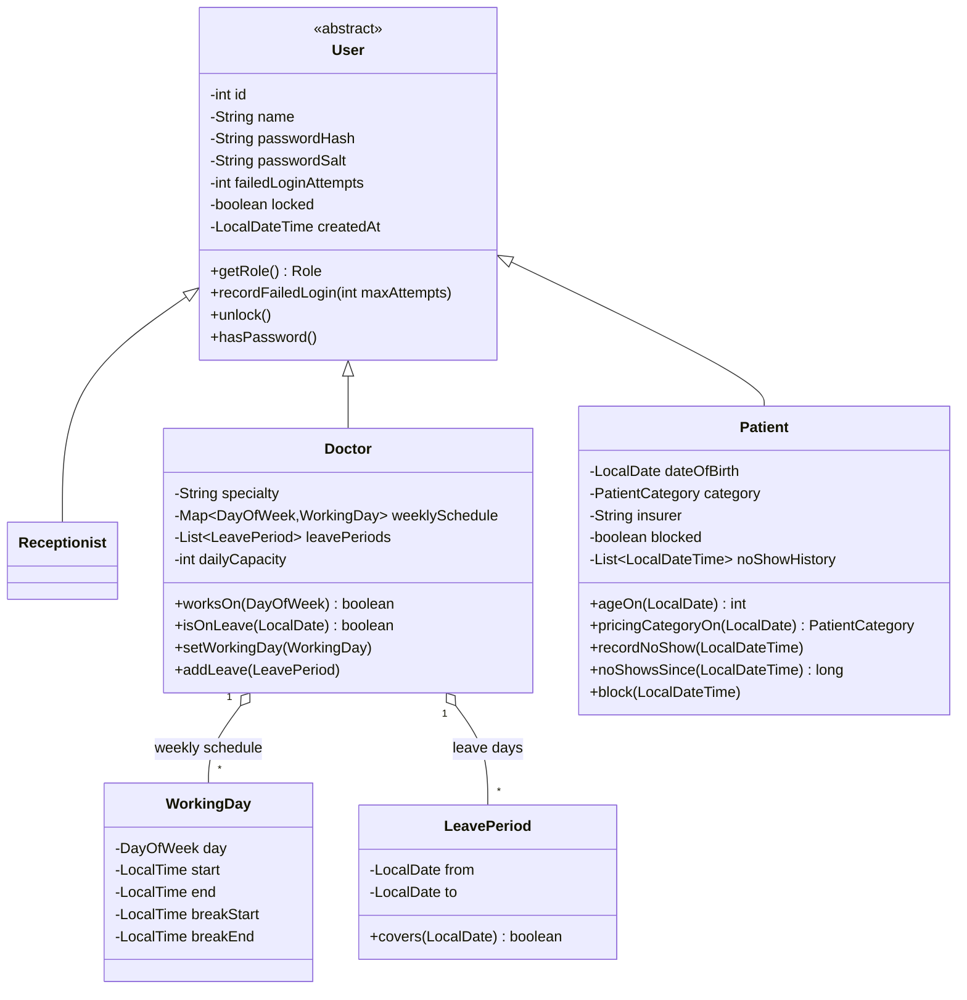
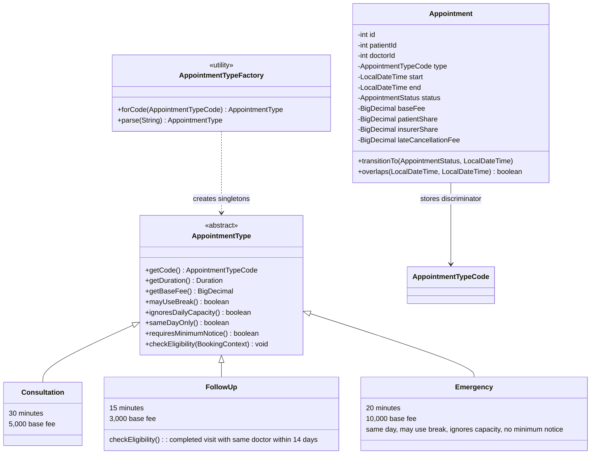
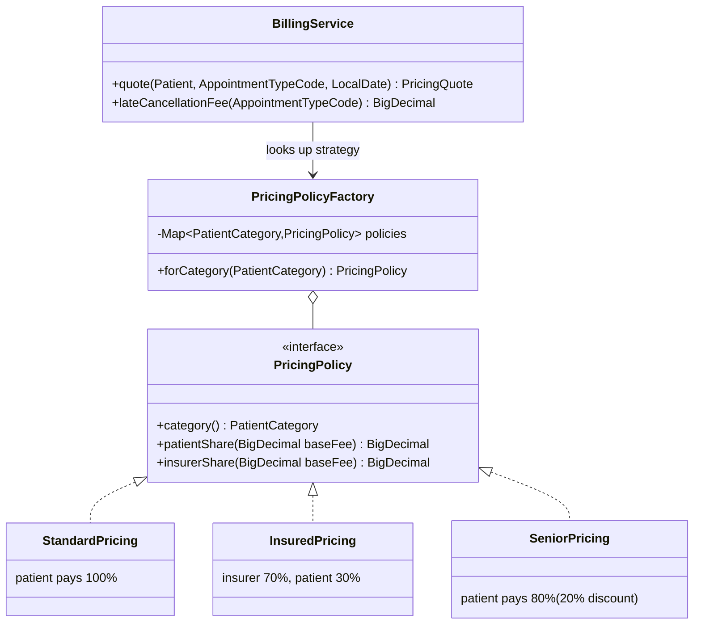
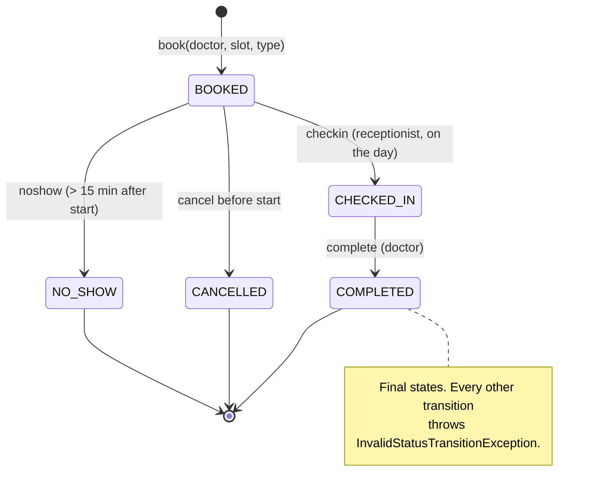
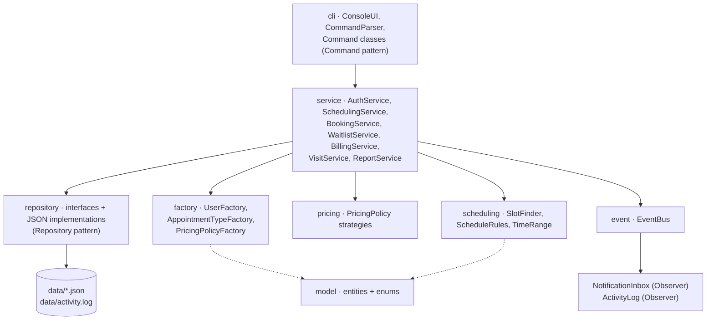
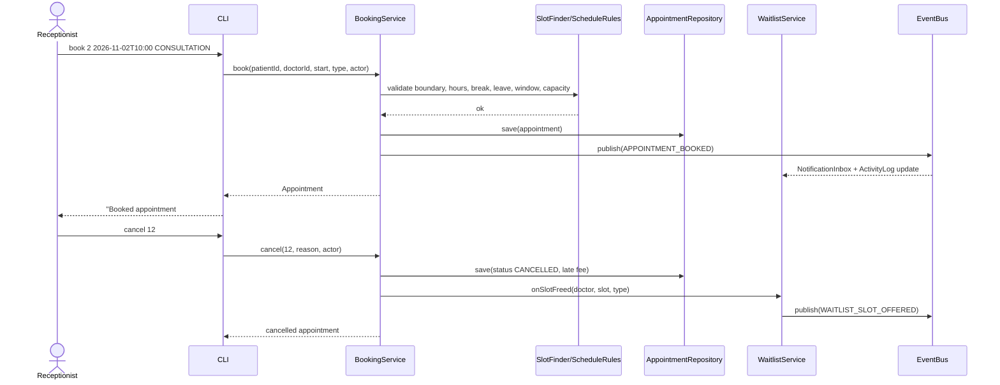

# UML and design diagrams

These diagrams use [Mermaid](https://mermaid.js.org/) so they render directly on GitHub and in
most Markdown viewers. The same information can be pasted into <https://mermaid.live> and
exported as PNG/SVG for the report.

---

## 1. User hierarchy (inheritance)



---

## 2. Appointment type hierarchy (inheritance + polymorphism)



---

## 3. Pricing strategies (Strategy pattern)



The billing service contains no `if/else` on the patient category; it asks the factory for the
policy and calls `patientShare` / `insurerShare` (open/closed principle).

---

## 4. Appointment lifecycle (state diagram)



A cancellation inside 24 hours of the start time charges 20% of the type's base fee. A
reschedule validates the new slot first and only then replaces the old booking (atomic), and
the freed slot is offered to the waiting list.

---

## 5. Layering and patterns



Rules:

* the CLI talks to services only (never repositories or JSON classes);
* services depend on repository **interfaces**, not on the JSON implementations;
* `Main` / `ClinicApp` is the composition root and the only place that constructs concrete
  implementations (manual dependency injection);
* `Clock` is injected everywhere instead of calling `LocalDateTime.now()`.

---

## 6. Key runtime collaborators



---

## 7. Package structure (required by the brief)

```
com.clinic
├── model/       User, Receptionist, Doctor, Patient, Appointment, AppointmentType,
│                Consultation, FollowUp, Emergency, WorkingDay, LeavePeriod, WaitlistEntry,
│                VisitRecord, Notification, Role + enums
├── service/     AuthService, SchedulingService, BookingService, WaitlistService,
│                BillingService, VisitService, ReportService (+ DTO records)
├── scheduling/  TimeRange, SlotFinder, ScheduleRules, SlotCell, SlotState
├── pricing/     PricingPolicy + StandardPricing, InsuredPricing, SeniorPricing
├── event/       ClinicEvent, EventType, EventBus, EventListener, NotificationInbox, ActivityLog
├── repository/  repository interfaces + JSON implementations + SequenceStore + JsonSupport
├── factory/     UserFactory, AppointmentTypeFactory, PricingPolicyFactory
├── cli/         CommandParser, Command, CommandRegistry, CommandContext, ConsoleUI, commands
├── exception/   ClinicException + 18 custom exceptions
└── util/        PasswordHasher, Formats, Validators
```
